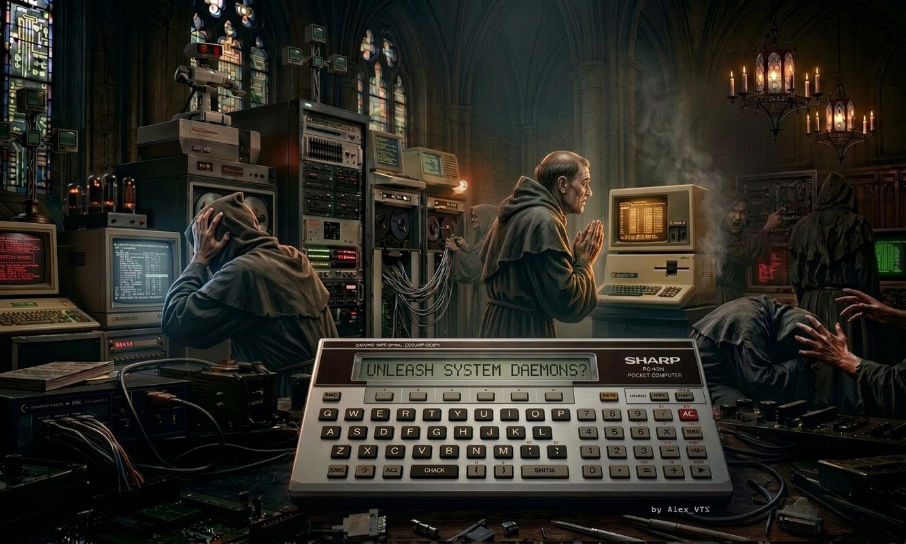

# BASTIONS OF RETROCOMPUTING - a strategy game for Sharp pocket computers

The **Cathodic Church** keeps ten Bastions of Vintage IT across Europe, from Lourdes to the Vatican. You lead a crew of
**Hackers** and **Gurus** who take the Bastions from the Tech Priests - nobody gets hurt, the war is fought with code. Buy Hackers,
Gurus, Daemons and Trojans for tokens, sell retro stuff, choose a place (it is fearful of one kind of attack), decide how many
fighters to send, collect the tax from the conquered places and save up for the Vatican. Keys: **F**ight, **B**uy, **S**ell,
**T**ax, **R**esources, **E**nd. Full rules are in the instructions (PDF / DOCX) in each folder.

The game is written in BASIC. The same algorithm runs on four families of machines, one folder each:

| Folder | Computer | Version |
|---|---|---|
| [PC1500](PC1500) | Sharp PC-1500, PC-1500A, Tandy PC-2 (needs the CE-150 for the tape, about 5.9 KB of RAM) | 2.6 |
| [PC1600](PC1600) | Sharp PC-1600 (verified on a real machine) | 2.6 |
| [PC1360](PC1360) | Sharp PC-1360 (4 x 24 characters; slow, use it only for fun) | 2.6 |
| [PCE500](PCE500) | Sharp PC-E500 and PC-E500S (4 x 40 characters; tested on the E500S) | 2.6 |

## Installation

1. Open the folder of your computer. It holds the BASIC listing (`.txt`), a recording for the tape input (`.wav`), the instructions and a short README.
2. **Tape:** connect the audio output of a computer or player to the cassette input and play the WAV.
   - PC-1500: PRO mode, `NEW0`, `CLOAD`, play `bastions-v2.6.wav` (about 7 minutes), RUN mode, `RUN`.
   - PC-1360: PRO mode, `CLOAD "BASTION"`, play the WAV, `RUN`.
   - PC-1600: MODE 0, `LOAD "CAS:"`, play the WAV, `RUN`.
3. **Serial port (listing as text):** PC-1600 (`LOAD "COM1:"`) and PC-E500(S) (`LOAD`) can receive the `.txt` listing from a terminal program; the
   [SerComet](https://github.com/Ante1000/SerComet_transfer_tool_for_pockets) transfer tool sends it for you. The PC-E500(S) has no recording here: use the serial port.
4. Details, memory needs and known limits are in the README of each folder.

The listings and recordings are tested on the machines named above; the PC-1500 archive folder holds the older versions 1.6 - 2.5
(listings and instructions only; their tape recordings are not copied here). The license is in [LICENSE.txt](LICENSE.txt).
